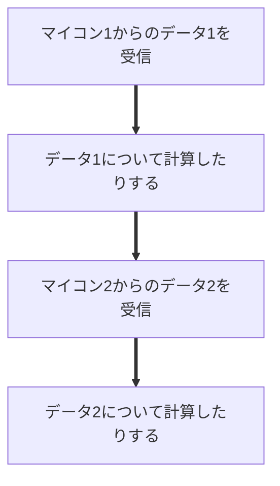

# 1.ROS2を使う理由
ここではROS2を使う理由について解説します。

{ width="500"}

---

## そもそもROS2って？:thinking_face:
{width="200" align=right}

ROS2とは[**OpenRobotics**](https://www.openrobotics.org/)という団体が開発したオープンソース（誰でも使えるプログラムのこと）であり、「ロボットアプリケーションの開発を支援するソフトウェア開発キットである」とされています。

**Robot Operation System**の略称であり、**「２」**がついているのはROSのバージョン2であるということです。

---

## プロセスとスレッド🔧
本題について理解していただくために、プログラムにおけるプロセスとスレッドについて説明させてください。

### プロセス
**プロセス**とはコンピュータの中で**独立して動いている1つひとつのプログラムのまとまり**のことです。

２つのラーメン屋さんがあったとします。
ここでひとつのラーメン屋さんが倒産したとしても、もうひとつのラーメン屋さんは倒産しませんよね？

このようにプロセスが２つ以上あるときに１つのプロセスがバグにより止まってしまっても他のプロセスは止まりません。

しかし、２つのラーメン屋さんの材料やキッチンを共有するのはとても難しいですよね。

このように２つのプロセスの間で変数などの情報を共有するのは難しいです。

{width="200" align=left}

{width="200" }

### スレッド

**スレッド**とは、プロセスの中にある「実際の処理の単位」のことです。1つのプロセスのなかで、複数の作業を同時に進めるために使われます。

{width="200" align=right}

ここでもプロセスをラーメン屋さんに見立てて考えましょう。

ラーメン屋さんには複数の店員がいて、作業を分担することができます。ずばり、この店員さん一人一人がスレッドなのです。

もちろん同じ店舗内に全員がいるので、**店員同士の材料の受け渡しは簡単で早い**です。

しかし、**一人の店員がスープに洗剤を入れてしまうと、店全体として営業を止めなければならなくなりますね**。

つまり１つのプロセス内で複数の作業を同時にこなすためにスレッドが３つあるとします。
これらの**スレッド同士で変数などの情報の共有をするのはとても簡単で早い**です。しかし、**１つでもスレッドがバグで止まってしまうとそのプロセスごとプログラムは止まります**。

## なぜROS2を使うのか
お待たせしました。ついに**本題**です。

実際のロボット向けソフトウェアの開発では**通信**や**計算**など**同時に行いたい作業**がいくつも出てきます。

ここでは２つのマイコンと通信する例を考えてみます。まずは並列処理（同時処理）をしなかった場合です。

この場合では本来、同時に行ってほしい２つのマイコンとの通信が、人の目にはわかりませんがわずかにマイコン２との通信が遅れることになってしまいます。