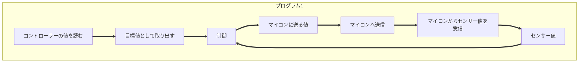
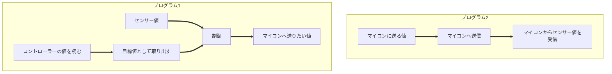
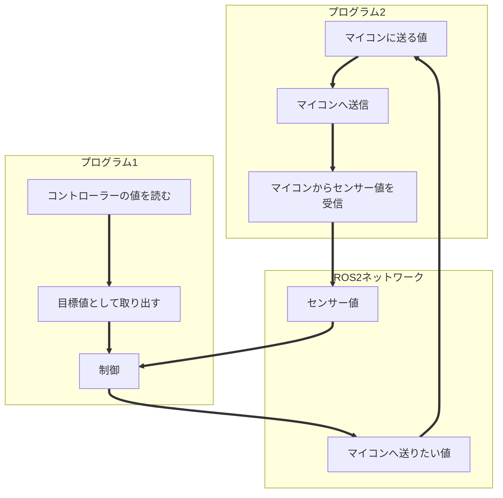

# 2.ROS2ができること
ここではROS2ができることについて解説します。

## プログラム同士の通信
ROS2のメイン機能と言ってもいいでしょう。**ROS2を使うことで独立で動いているプログラム同士で変数を共有することができる**ようになります。

コントローラーの値を読んで、マイコンからのセンサー値を用いて制御したいケースを考えます。

ひとつのプログラムとして作成するのならば以下のようになるでしょう。

しかしこれでは以下のような問題点があります。

- 制御ループの周期が一定になりにくい
- 通信の周期が一定にならないので不安定になる可能性がある
- ひとつのプログラムにたくさんのコードを書くことになるので後から読みづらいコードになってしまう

ということで機能ごとにプログラムを分割することを考えます。
以下のようになりました。

しかしこれでは、プログラム１から「マイコンへ送りたい値」をプログラム２に渡す必要があるし、プログラム２から「センサー値」をプログラム１へ渡す必要が出てしまいました。

これを自分で書こうとすると一筋縄ではいきません。（UDP通信で繋ぐことを考えるとタイミングであったり、データ形式を考える必要が出てきますからね）

そこでROS2を使うわけです。

このようにROS2を用いることで、それまで独立していた複数のプログラムを円滑に繋ぐことができました。

今回は規模の小さい例を考えましたが、ROS2の恩恵は規模が大きくなるほど感じられるはずです。

例えばモーターごとに制御を分ける場合などは同じファイルにコード全体を書いてしまうと後から「どこに書いたっけ？」となってしまいます

## その他
他にも以下のような多種多様な機能をROS2は有しています。

- 点群、カメラ映像のリアルタイム可視化
- yamlファイルによるパラメータ読み込み
- Launchによる複数プログラム同時起動
- 一対多、多対一の通信
- あるプログラムを一定周期で実行する
- あるプログラムを一定周期で実行しながら、他のプログラムと通信する

あまりに多いので、ここで書ききるのではなく、使いながら理解したほうが良いと思います。