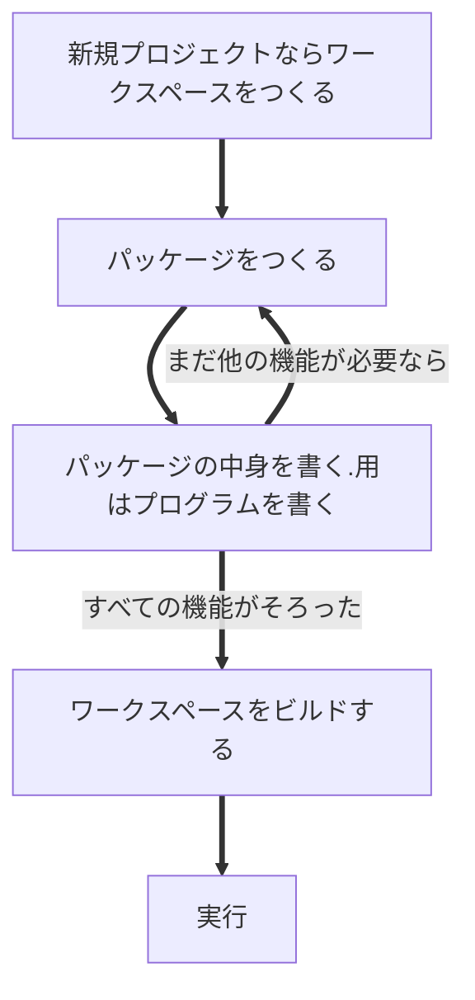
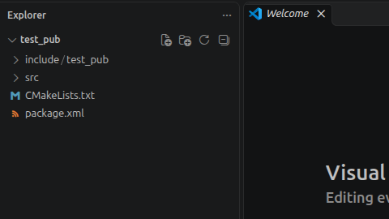
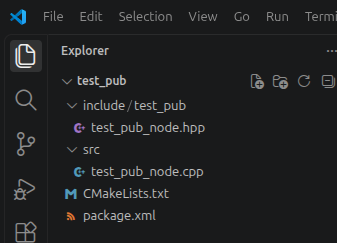
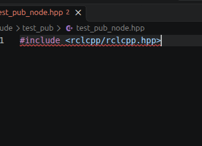
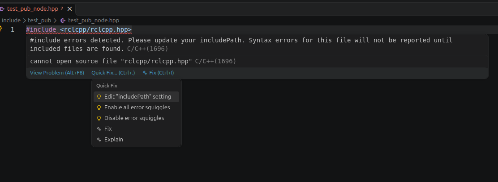

# 4.ROS2ノードを作成しよう
ついにROS2を動かすときが来ました

## ros2コマンドを使うために
まずros2コマンドを使うための準備をしましょう

以下のように、何のフォルダにも入ってないところで、`code .`と実行してください。これでVisualStudioCodeを開くことができます。

```sh
user@user-laptop:~$ code .
```

そして`.bashrc`というファイルを探して開いてください

さらに`.bashrc`の最後の行を改行して以下の内容を追加しましょう

```sh
. opt/ros/jazzy/setup.bash
```

そうしたら、ターミナルを一回閉じて、もう一度開いてください

## ROS2の開発の流れ
ROS2では以下の開発の流れがあります。



ROS2開発では複数のパッケージを一括でビルドする`colcon`というツールを用いるのですが、

毎回毎回、これまで作ってきたすべてのパッケージをビルドされてもビルド時間が長くなってしまって困ります。

そこでROS2ではワークスペースという区切りをつくってその中に使うパッケージを作っていくという方式を取ります。

１つソフトウェアを作るたびに１つワークスペースを作るイメージです。

## ワークスペースをつくる

{width="200" align=right}

ワークスペースという名前を特に意識する必要はありません。

以下のようにコマンドを使ってフォルダを作るだけです。

今回はテストなので`test_ws`という名前（wsはwork spaceの略）のフォルダを

`mkdir`というコマンド（ただフォルダを作るコマンド）を使って作りましょう。

```sh
mkdir test_ws
```

そして`test_ws`に移動してその中で`src`という名前のフォルダを作ってください。

これからはこの`src`というフォルダの中にパッケージを作成していきます。

```sh
cd test_ws
```
```
mkdir src
```

> 注意
> 
> ワークスペースについてはgod_softwareとか
> smart_systemのように好きな名前をつけても大丈夫です。

> しかし、「src」というフォルダについては名前を変えてしまうとビルドツールがパッケージを見つけれなくなるので
> 「src」という名前については変えないでください。

## パッケージをつくる

{width="200" align=right}

ROS2パッケージを作成していきます。

`test_ws`の中の`src`の中に移動してください。
移動できていたら、以下のように画面に表示されていると思います。
```sh
user@user-laptop:~/test_ws/src$ 
```

ではros2コマンドを使って`test_pub`というROS2パッケージを作成しましょう。以下のコマンドです。
```sh
ros2 pkg create --build-type ament_cmake test_pub
```
`ros2 pkg create`についてはそのままの意味です。

`--build_type ament_cmake`というのは作成する際のオプションで、

これから作るパッケージが言語に**C++**を用いるため、`cmake`というC言語における依存関係を解決するツールを使うのでこのように指定しました。

> 依存関係とは

> ROS2のように自分が書いたわけではないけど、実行するために読み込みたいプログラムのことを言います。

> これから私達が作るプログラムはROS2の存在に「依存」しているのです。

最後にパッケージの名前をつけています。

成功すると以下のような出力になります。

```sh
user@user-laptop:~/test_ws/src$ ros2 pkg create --build-type ament_cmake test_pub
going to create a new package
package name: test_pub
destination directory: /home/user/test_ws/src
package format: 3
version: 0.0.0
description: TODO: Package description
maintainer: ['motii <default270robo@gmail.com>']
licenses: ['TODO: License declaration']
build type: ament_cmake
dependencies: []
creating folder ./test_pub
creating ./test_pub/package.xml
creating source and include folder
creating folder ./test_pub/src
creating folder ./test_pub/include/test_pub
creating ./test_pub/CMakeLists.txt

[WARNING]: Unknown license 'TODO: License declaration'.  This has been set in the package.xml, but no LICENSE file has been created.
It is recommended to use one of the ament license identifiers:
Apache-2.0
BSL-1.0
BSD-2.0
BSD-2-Clause
BSD-3-Clause
GPL-3.0-only
LGPL-3.0-only
MIT
MIT-0

```

## ノードを作成する

`test_pub`を**Visual Studio Code**で開くと写真のようになると思います



- `include/test_pub`　この中に`.hpp`のようなヘッダーファイルを置く
- `src`　`.cpp`のようにC++ソースコードを置く
- `CMakeLists.txt`　依存関係の取り扱いを書くファイル
- `package.xml` パッケージの詳細について書くファイル

### package.xmlの編集

まずは`package.xml`について書きましょう。デフォルトでは以下のようになっています。

```xml
<?xml version="1.0"?>
<?xml-model href="http://download.ros.org/schema/package_format3.xsd" schematypens="http://www.w3.org/2001/XMLSchema"?>
<package format="3">
  <name>test_pub</name>
  <version>0.0.0</version>
  <description>TODO: Package description</description>
  <maintainer email="user@abcd.com">user_name</maintainer>
  <license>TODO: License declaration</license>

  <buildtool_depend>ament_cmake</buildtool_depend>

  <test_depend>ament_lint_auto</test_depend>
  <test_depend>ament_lint_common</test_depend>

  <export>
    <build_type>ament_cmake</build_type>
  </export>
</package>
```

ここに、今回用いる依存関係である`rclcpp`と`std_msgs`を追加してください。

以下のようになります。

```xml
<?xml version="1.0"?>
<?xml-model href="http://download.ros.org/schema/package_format3.xsd" schematypens="http://www.w3.org/2001/XMLSchema"?>
<package format="3">
  <name>test_pub</name>
  <version>0.0.0</version>
  <description>TODO: Package description</description>
  <maintainer email="user@abcd.com">user_name</maintainer>
  <license>TODO: License declaration</license>

  <buildtool_depend>ament_cmake</buildtool_depend>

  <!-- ここから新しい -->
  <depend>rclcpp</depend>
  <depend>std_msgs</depend>
  <!-- ここまで新しい -->

  <test_depend>ament_lint_auto</test_depend>
  <test_depend>ament_lint_common</test_depend>

  <export>
    <build_type>ament_cmake</build_type>
  </export>
</package>

```

### CMakeLists.txtの編集
こちらはデフォルトで以下のようになっているはずです。
```cmake
cmake_minimum_required(VERSION 3.8)
project(test_pub)

if(CMAKE_COMPILER_IS_GNUCXX OR CMAKE_CXX_COMPILER_ID MATCHES "Clang")
  add_compile_options(-Wall -Wextra -Wpedantic)
endif()

# find dependencies
find_package(ament_cmake REQUIRED)
# uncomment the following section in order to fill in
# further dependencies manually.
# find_package(<dependency> REQUIRED)

if(BUILD_TESTING)
  find_package(ament_lint_auto REQUIRED)
  # the following line skips the linter which checks for copyrights
  # comment the line when a copyright and license is added to all source files
  set(ament_cmake_copyright_FOUND TRUE)
  # the following line skips cpplint (only works in a git repo)
  # comment the line when this package is in a git repo and when
  # a copyright and license is added to all source files
  set(ament_cmake_cpplint_FOUND TRUE)
  ament_lint_auto_find_test_dependencies()
endif()

ament_package()

```

同じことを書いているようですが、ここにもう一度`rclcpp`と`std_msgs`を使うことを宣言しましょう
`find_package(rclcpp REQUIRED)`と`find_package(std_msgs REQUIRED)`を追加します。

次にこのパッケージの中でどのファイルが実際に動かしたいファイルかを以下のように指定します。

```cmake
add_executable(test_pub_node src/test_pub_node.cpp)
```

Windowsではないので、実際にあるわけではありませんが、これでビルド時に`test_pub_node.exe`のようなものができます。

`src/test_pub_node.cpp`はそのファイルがある場所を指定しています

くどいようですが、`test_pub_node`に依存関係の紐付けを以下のように行う必要があります。
```cmake
ament_target_dependencies(test_pub_node rclcpp std_msgs)
```

以下を書くことでビルドするときに`include/test_pub`内のファイルも見てくれるようにしてください
```cmake
target_include_directories(test_pub_node
  SYSTEM PUBLIC
  $<BUILD_INTERFACE:${CMAKE_CURRENT_SOURCE_DIR}/include>
)
```

そして最後、以下のように書いてros2コマンドが実行ファイルを見つけられるようにしましょう。

```cmake
install(TARGETS
  test_pub_node
  DESTINATION lib/${PROJECT_NAME}
)
```

**すべて理解する必要がありません。CMakeLists.txtが以下のようになってればOKです。**

```cmake
cmake_minimum_required(VERSION 3.8)
project(test_pub)

if(CMAKE_COMPILER_IS_GNUCXX OR CMAKE_CXX_COMPILER_ID MATCHES "Clang")
  add_compile_options(-Wall -Wextra -Wpedantic)
endif()

# find dependencies
find_package(ament_cmake REQUIRED)
# uncomment the following section in order to fill in
# further dependencies manually.
# find_package(<dependency> REQUIRED)

# 今回書いたこと　始まり
find_package(rclcpp REQUIRED)
find_package(std_msgs REQUIRED)

add_executable(test_pub_node src/test_pub_node.cpp)

target_include_directories(test_pub_node
  SYSTEM PUBLIC
  $<BUILD_INTERFACE:${CMAKE_CURRENT_SOURCE_DIR}/include>
)

ament_target_dependencies(test_pub_node rclcpp std_msgs)

install(TARGETS
  test_pub_node
  DESTINATION lib/${PROJECT_NAME}
)
# 今回書いたこと　終わり

if(BUILD_TESTING)
  find_package(ament_lint_auto REQUIRED)
  # the following line skips the linter which checks for copyrights
  # comment the line when a copyright and license is added to all source files
  set(ament_cmake_copyright_FOUND TRUE)
  # the following line skips cpplint (only works in a git repo)
  # comment the line when this package is in a git repo and when
  # a copyright and license is added to all source files
  set(ament_cmake_cpplint_FOUND TRUE)
  ament_lint_auto_find_test_dependencies()
endif()

ament_package()

```

### ノードを書く
やっとC++書きます。（遅くなりましたごめんなさい）

`include/test_pub`の中に`test_pub_node.hpp`、そして`src`の中に`test_pub_node.cpp`を新規作成します。



`test_pub_node.hpp`から編集しましょう。一行目に`#include <rclcpp/rclcpp.hpp>`と書くと、赤い波線が引かれると思います。



これはパソコンにros2がインストールされていても、その場所をVisual Studio Codeに教えていないために起こります。

赤い波線にマウスカーソルを合わせて、`Quick Fix...(Ctrl+.)`をクリックしてください。すると以下のような画面が出るはずです。



そして`Edit "includePath" setting`をクリックしましょう

すると.vscodeというフォルダができるはずです。

その中にある`c_cpp_properties.json`を開いてください
```json
{
    "configurations": [
        {
            "name": "Linux",
            "includePath": [
                "${workspaceFolder}/**"
            ],
            "defines": [],
            "compilerPath": "/usr/bin/gcc",
            "cStandard": "gnu17",
            "cppStandard": "gnu++17",
            "intelliSenseMode": "linux-gcc-x64"
        }
    ],
    "version": 4
}
```

これを以下のようにすると先程の赤波線を解消できるはずです。
```json
{
    "configurations": [
        {
            "name": "Linux",
            "includePath": [
                "${workspaceFolder}/**",
                "/opt/ros/jazzy/include/**"
            ],
            "defines": [],
            "compilerPath": "/usr/bin/gcc",
            "cStandard": "gnu17",
            "cppStandard": "gnu++17",
            "intelliSenseMode": "linux-gcc-x64"
        }
    ],
    "version": 4
}
```

`test_pub_node.hpp`を以下のように編集してください。
```cpp

#include <rclcpp/rclcpp.hpp> // ROS2本体のライブラリ
#include <std_msgs/msg/string.hpp> // 今回、通信で使うデータ形式（ROS2ではメッセージという）

// ここからはROS2ではなく、C++のライブラリ
#include <chrono> // 時間を扱うため
#include <string> // 文字列を扱うため

//　名前空間を定義する
// 名前は何でも良いが作るノードの名前と一致していると良い
// 名前空間の名前は大文字を使わない
namespace test_pub_node 
{
    // TestPubNodeというクラスを定義する
    //（クラス名はなんでも良いが、作るノードの名前と一致していると良い）
    // クラス名はアンダーバーを使わない
    // rclcpp::Nodeというクラスを継承する
    class TestPubNode : public rclcpp::Node
    {
        // 関数の中身を書かず、宣言する(プロトタイプ宣言)
        // 関数の中身を.cpp側で書きたいのでpublicの下に書いてる
        public:
        // コンストラクタと呼ばれる関数
        // この名前はクラス名と一致してなければならない
        TestPubNode();

        // タイマーで呼び出す関数
        void timer_callback();

        // 変数は基本、プライベートで宣言する
        private:
        // プログラム中で保持される変数にはすべて名前のあとにアンダーバーをつける決まり
        // 一時的な変数と区別するため

        // タイマー
        rclcpp::TimerBase::SharedPtr timer_;
        // データを送信する本体
        // <>の中身でデータ形式を指定しているような感じ
        rclcpp::Publisher<std_msgs::msg::String>::SharedPtr publisher_;

        // 数字を数えるための変数
        int count;
    };
}
```

コメント文で最低限のことは書きましたが、言語的な詳細は[C++チュートリアルのクラス](../../tutorial/software/cpp/09.class.md)と[C++チュートリアルの名前空間](../../tutorial/software/cpp/06.namespace.md)などを読んでくれると嬉しいです。
> ROS2は大体、この書き方で決まっているので意味がわからなくても良いです。


次に`test_pub_node.cpp`を編集しましょう

```cpp
#include "test_pub/test_pub_node.hpp"

namespace test_pub_node
{
    // コンストラクタの中身を書く
    // Node("test_pub_node")は
    TestPubNode::TestPubNode() : Node("test_pub_node")
    {
        count_ = 0;

        // Publisherを初期化する
        // "/test"はトピック名といって、通信経路の名前である。通信相手の名前を書くわけではない
        // よってこのpublisher_は「/test」というところにデータを投げる
        // 「rclcpp::SystemDefaultsQoS()」というのはQoS（Quality of Service）といって深くは説明しない。
        // 毎回、「rclcpp::SystemDefaultsQoS()」でOk
        publisher_ = this->create_publisher<std_msgs::msg::String>("/test", rclcpp::SystemDefaultsQoS());

        using namespace std::chrono_literals; // これを書くと、時間の単位をC++で書けるようになる
        
        // TimerBaseを初期化する
        // timer_callbackを１秒に１回呼び出す
        // 「std::bind(...」のところは理解しなくてOK。ここでTestPubNode::timer_callbackと呼び出す関数を指定していることがわかればよい
        timer_ = this->create_wall_timer(
            1000ms, 
            std::bind(&TestPubNode::timer_callback, this)
        );

        // RCLCPP_INFOはprintfのようなもの
        RCLCPP_INFO(this->get_logger(), "test_pub_nodeを起動しました。");
    }

    void TestPubNode::timer_callback()
    {
        // 今回送るメッセージはString（文字列）である
        // autoは型推論というものでコンパイラが勝手に型を決めてくれる
        // std_msgs::msg::Stringは構造体
        auto publish_msg = std_msgs::msg::String();

        // 送る文章を代入する
        publish_msg.data = "Hello, World, " + std::to_string(count_);

        count_++;

        // publisher_がpublish_msgを送信する
        // rclcpp::Publisherというクラスはpublishという関数をもっている
        publisher_->publish(publish_msg);

        RCLCPP_INFO(this->get_logger(), "送信しました：%s", publish_msg.data.c_str());
    }
}

// 以下、実際に動くメインコードだが、ひとまず呪文でOK
// rclcpp::spinの中身を定義したクラスにしよう
int main(int argc, char * argv[])
{
  rclcpp::init(argc, argv);
  rclcpp::spin(std::make_shared<test_pub_node::TestPubNode>());
  rclcpp::shutdown();
  return 0;
}
```

これについても**コメント文は書いたが、詳しい解説は省くことにする**。気になる人はAIに聞いたりしても良き

ひとつだけ補足すると、頻繁に登場した`::`は名前空間の中の構造体とかを使いたいときに用います。

例えば以下のように関数を定義していたら
```cpp
namespace language
{
    namespace japanese
    {
        void greed()
        {
            printf("こんにちは！\n");
        }
    }

    namespace america
    {
        void greed()
        {
            printf("Hello！\n");
        }
    }
}
```

メイン関数では以下のように呼ぶのがC++の書き方です
```cpp
int main(void)
{
    language::japanese::greed();    // 「こんにちは！」と表示される
    language::america::greed();     // 「Hello!」と表示される

    return 0;
}
```

## ROS2パッケージをビルドする

{width="200" align=right}

これでパッケージ作成が完了したので、パッケージをビルドします。

**注意してほしいのが、ROS2のビルドは毎回、ワークスペースで行うことだ。**

今回であればビルドを行うのは`test_ws`にいるとき、ということです。

以下がビルドコマンドです。
```sh
colcon build --symlink-install
```

`test_ws`で実行するので以下のようになってたらOKです。
```sh
user@user-laptop:~/test_ws$ colcon build --symlink-install
Starting >>> test_pub
Finished <<< test_pub [3.73s]                     

Summary: 1 package finished [3.90s]

```

## ROS2ノードを実行する
ビルドが完了したらワークスペース内に`build`、`install`、`log`のフォルダができます。

実行するためには`.exe`的な物の場所を知る必要があるのですが、なんと`install`内にsetup.bashというファイルが作成されており、これを実行するだけでで実行ファイルの特定は終わります。

```sh
. install/setup.bash
```
今回は`test_ws`内で実行するのでこういう感じです。またこのスクリプトに出力はございません。
```sh
user@user-laptop:~/test_ws$ . install/setup.bash
user@user-laptop:~/test_ws$ 
```

ros2で書いたプログラムは`ros2 run`で実行することができます。フォーマットは以下のとおりです。
```sh
ros2 run パッケージ名 ノード名
```
ここで「ノード名」とは`CMakeLists.txt`で`add_executable`したときの名前です。

すなわち今回は以下のようになります。

```sh
ros2 run test_pub test_pub_node
```

これを実行すると以下のように出力されるはずです。
```sh
user@user-laptop:~/test_ws$ ros2 run test_pub test_pub_node 
[INFO] [1792329584.628141161] [test_pub_node]: test_pub_nodeを起動しました。
[INFO] [1792329585.628457019] [test_pub_node]: 送信しました：Hello, World, 0
[INFO] [1792329586.628422211] [test_pub_node]: 送信しました：Hello, World, 1
^C[INFO] [1792329586.788772936] [rclcpp]: signal_handler(SIGINT/SIGTERM)
user@user-laptop:~/test_ws$ 
```
ros2は`Ctrl-C`で止めることができます。

とりあえず１秒に１回動いていることがわかっただけですね。

次の章で受信側を書くことでプログラム同士の通信ができていることを確認していただけたら良いなと思います。