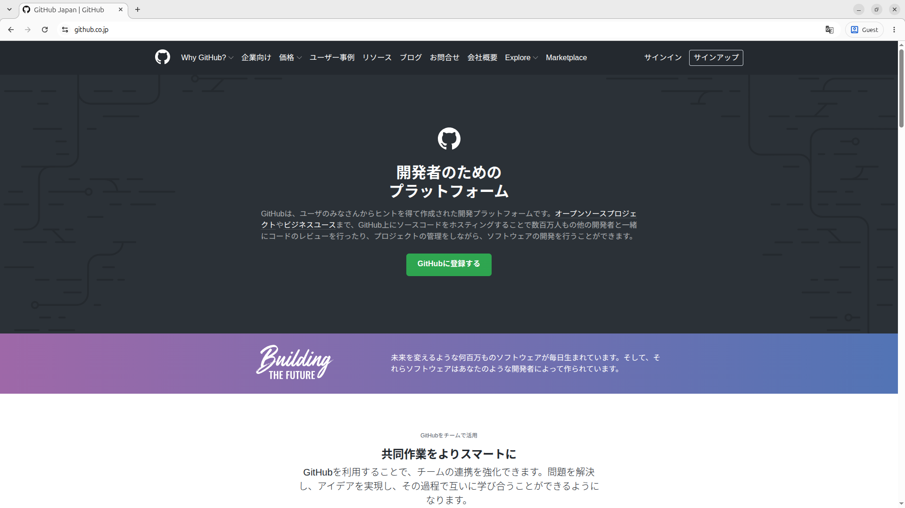
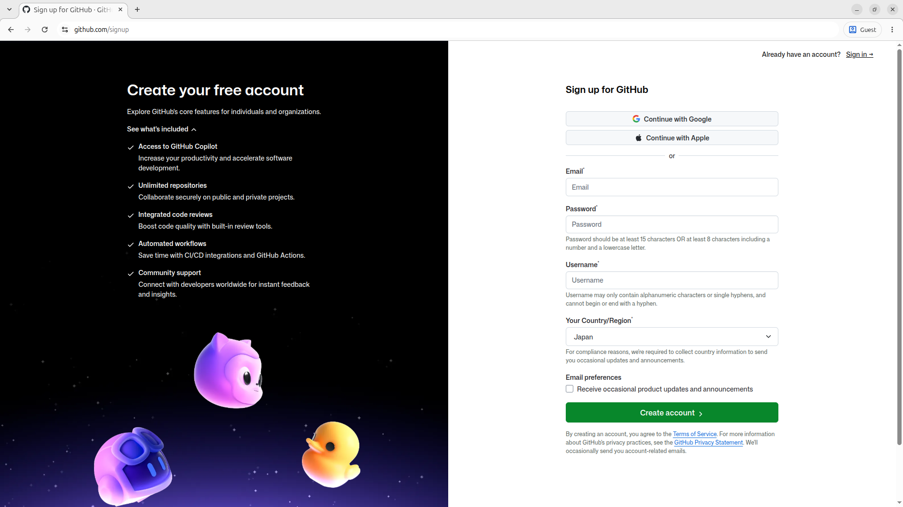
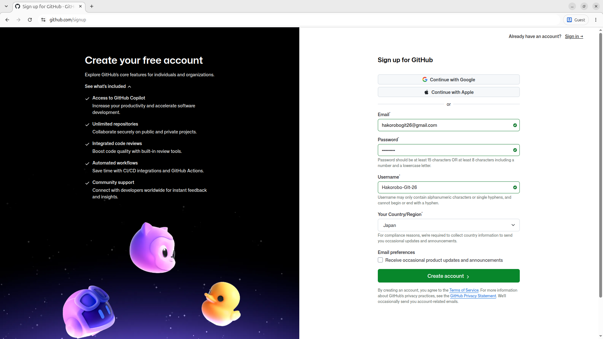
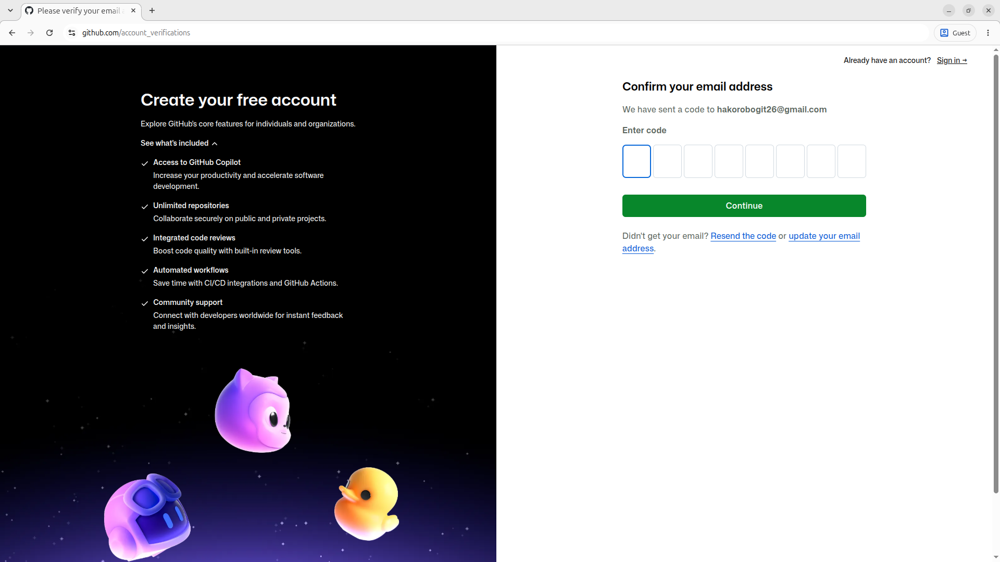
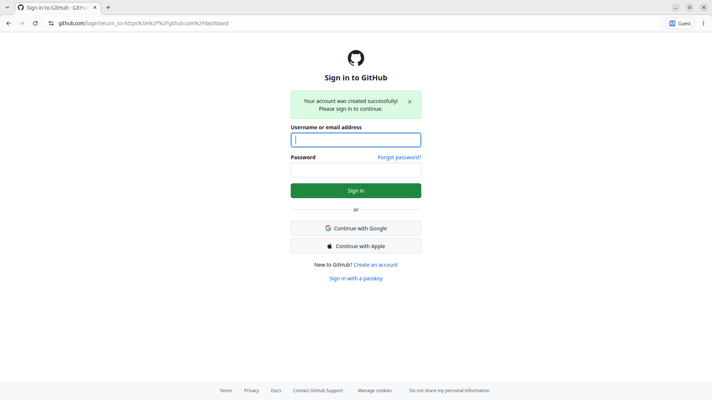
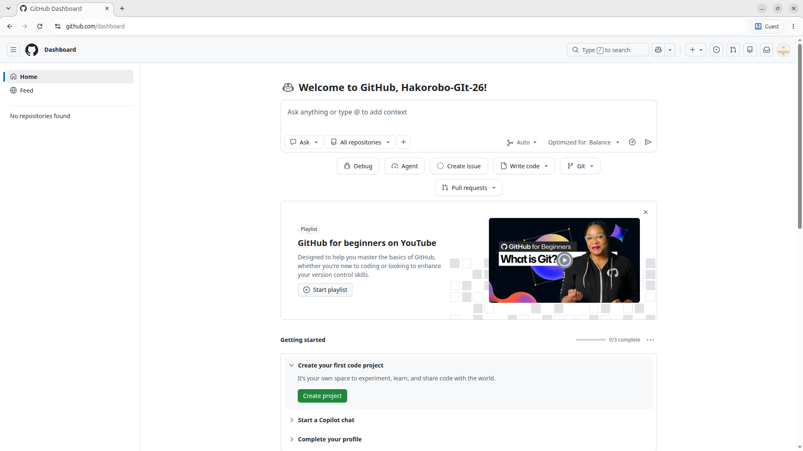

# GitHubのアカウントをつくろう

## GitHubサイトへ飛ぶ
[**https://github.co.jp/**](https://github.co.jp/)にアクセスして以下のページに飛んでください。そして、右上の**サインアップ**ボタンからGitHubアカウントを作成しましょう。

!!! 日本語について
    ここで悲しいお話です  
    GitHubが日本語対応しているページはここだけです...  
    これ以降のページはすべて英語になっており、言語設定はありません:sob:   
    最初はブラウザの翻訳機能を使いながらでもいいので、頑張りましょう！

## アカウント情報を入力
以下のページがでたらお好きな自分のメールアドレス、パスワードなどを入力してください。  
写真の後に詳しく説明を書いておきます。

| 項目 | 説明 |
|:----|:----|
| Email | お好きな自分のメールアドレスを入力してください。 |
| Password | 15文字以上か、8文字以上で数字と小文字を両方含んでいるものを入力してください。 |
| Username | お好きなユーザー名を入力してください。英数字とハイフンを使用できます。 |
| Your Country | 最初からJapanが入力されてると思うので、そのままで大丈夫です。 |
| Email preferences | メールを受け取りますか？なので、基本チェックマークはつけなくていいです。 |

!!! メールアドレスについて
    高専のものでも良いですが、Gmailなど個人のもので作ることをオススメします  
    高専のメールアドレスは卒業のタイミングで使えなくなるので、卒業後はログインできなくなってしまいます

こんな感じに入力しました。

## メール認証をする
AIじゃないことを証明したら、設定したメールアドレスに８桁の番号がとどくので、それを入力してください。

## ログイン画面に到着

ここでようやくログイン画面にたどり着けたので、先程入力したユーザー名とパスワードを入力してください。

## 完成
この画面になったら完成です。

次はGitについて学んでみましょう。

[2.Gitをどうやって使おう？](./02.how_to_use_git.md)  /  [一覧にもどる](./index.md)