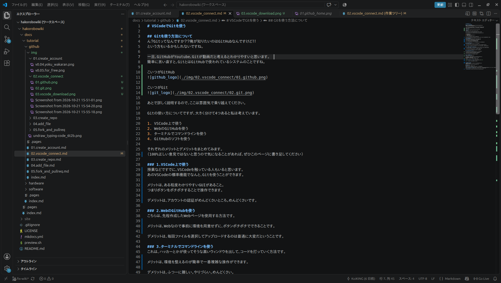
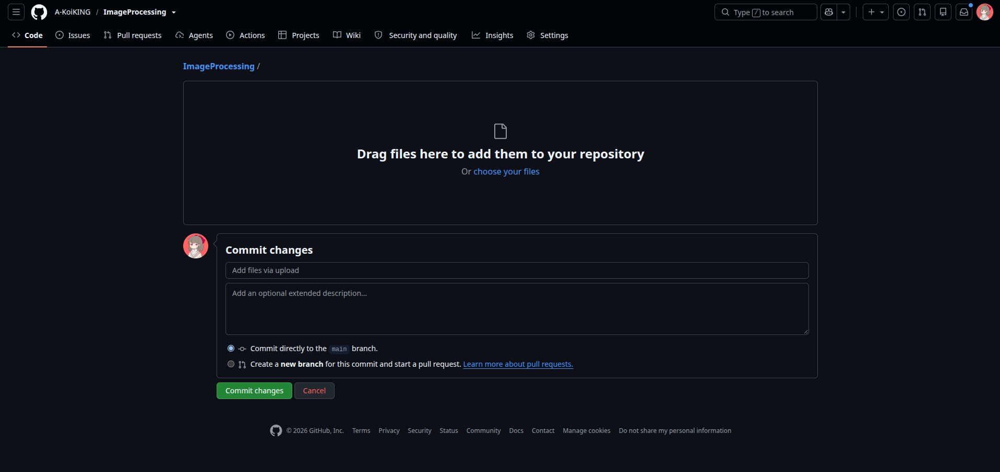
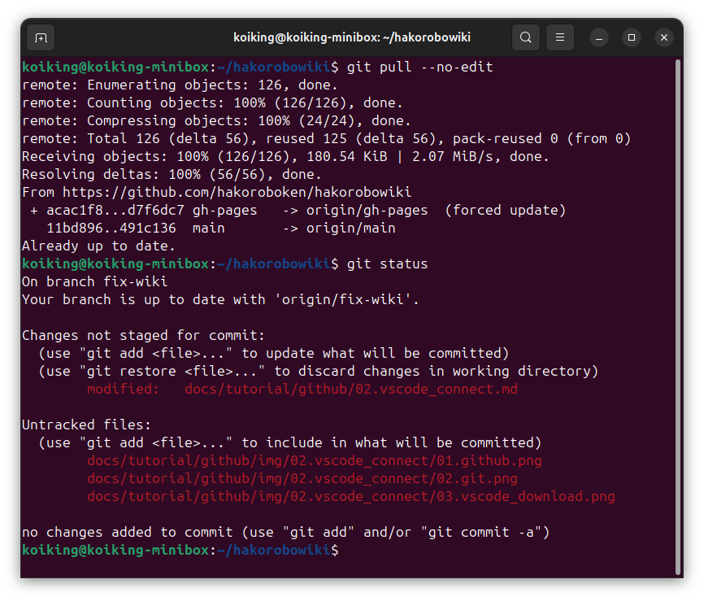
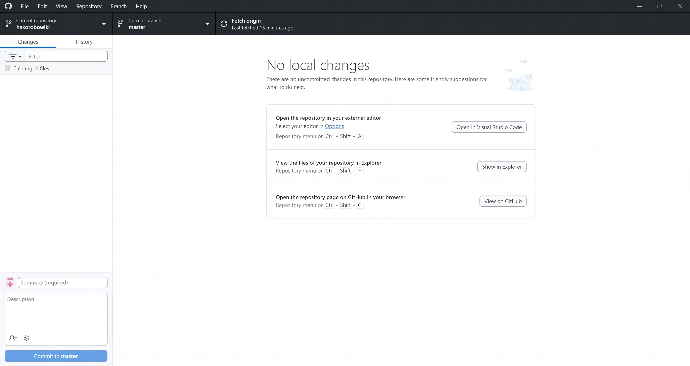

# Gitをどうやって使おうか？
**このページは座学なので、作業だけしたい人は飛ばしても大丈夫です。**  

次のページ >> [3.環境を整えよう](./03.create_repo.md)

## Gitを使う方法について
ん？Gitってなんですか？？俺が知りたいのはGitHubなんですけど！！  
という方もいるかもしれないですね。  

一旦、**GitHubがYoutube**、**Gitが動画**だと考えるとわかりやすいと思います。  
簡単に言い直すと、GitとはGitHubで使われているシステムのことですね。  

こいつがGitHub

こいつがGit

なんとなくで問題ないので、ここは雰囲気で乗り越えてください。  

Gitの使い方についてですが、大きく分けて4つあると私は考えています。

1. VSCode上で使う
2. WebのGitHubを使う
3. ターミナルでコマンドラインを使う
4. GitHubのソフトを使う

それぞれのメリットとデメリットをまとめてみます。  
（100%正しい意見ではないと思うので気になることがあれば、ぜひこのページに書き足してください）

### 1.VSCode上で使う
授業などですでに、VSCodeを触っている人もいると思います。  
あのVSCodeの標準機能で、なんとGitを使うことができます。

メリットは、ある程度わかりやすいGUIがあること。  
つまりボタンをポチポチすることで操作できます。  

デメリットは、アカウントの認証がめんどくさいところ。めんどくさいです。

### 2.WebのGitHubを使う
こちらは、先程作成したWebページを使用する方法です。  

メリットは、Webなので事前に環境を用意せずに、ボタンポチポチでできることです。  

デメリットは、毎回ファイルを選択してアップロードするのは普通に大変だということです。

### 3.ターミナルでコマンドラインを使う
これは、ハッカーとかが使ってそうなウィンドウを出して、コードを打っていく方法です。  

メリットは、環境を整えるのが簡単で一番複雑な操作ができます。  

デメリットは、ふつーに難しい。やりづらい。めんどくさい。

### 4.GitHubのソフトを使用する
正式名称は、GitHub Desktopですね。こちらを使用する方法です。  

メリットは、他の様々なソフトと同じように導入が楽です。  
(Windows,Macに対応しているみたいです。)  
Linuxをハブるな。  

デメリットは、少しだけ使いにくいところです。

### 結局どうしてきたか
私は、この4つを触ってきました。  

その上で、これまでは4のGitHubDesktopを1年生に教えてきました。  
理由は準備しやすいからです。  
exeファイルをダブルクリックすれば誰でも使えます。  

しかし、これにはとっても大きな問題があります。  

コイツを開く習慣がない  

これは...単純ですが、なかなか難しい問題ですね...

### じゃあどうするか
そこで、一番使う習慣がもともとあるものはなにか、考えました。  
**そうVSCodeですね。**  
こいつはなんだかんだ開く機会が多いとは思います。  

次は実際に環境を用意していきましょう。

[3.Gitの環境を用意しよう](./03.vscode_connect.md)  /  [一覧にもどる](./index.md)