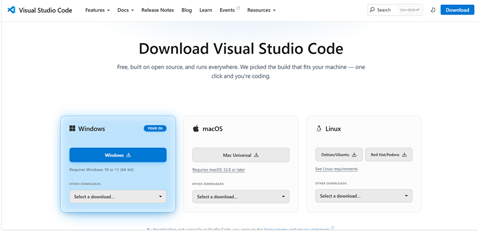

# Gitをどうやって使おうか？

## 準備していく

### VScodeを入れる
では、VSCodeを入れていきましょう。  
すでに入れているよって人はサーッと飛ばしてもらって大丈夫です。

[code.visualstudio.com/download](https://code.visualstudio.com/download)から、インストーラーをダウンロードしてください。  
Windowsって書いてあるボタンをクリックすればダウンロードが始まると思います。  

VSCodeUserSetupなんちゃらかんちゃら.exeファイルがダウンロードできると思います。  

ダブルクリックすると、ウィンドウが開きます。  
規約に同意して、全部次へを押してください。  
デスクトップショートカットが欲しい人は追加しておいてもいいと思います。

### Gitを入れる