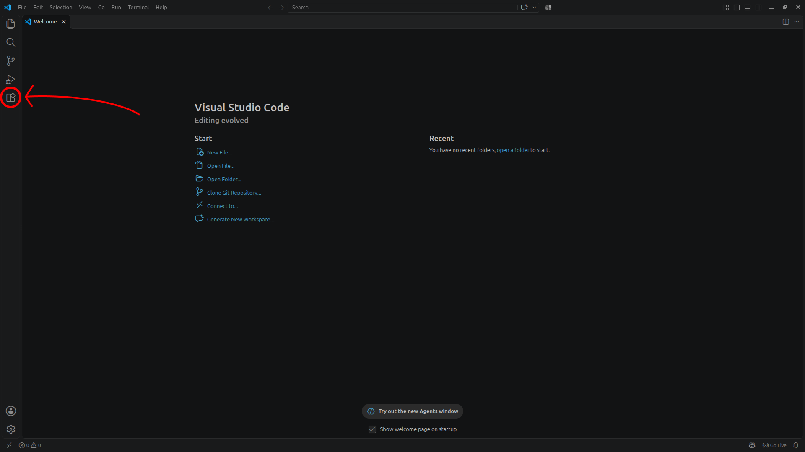
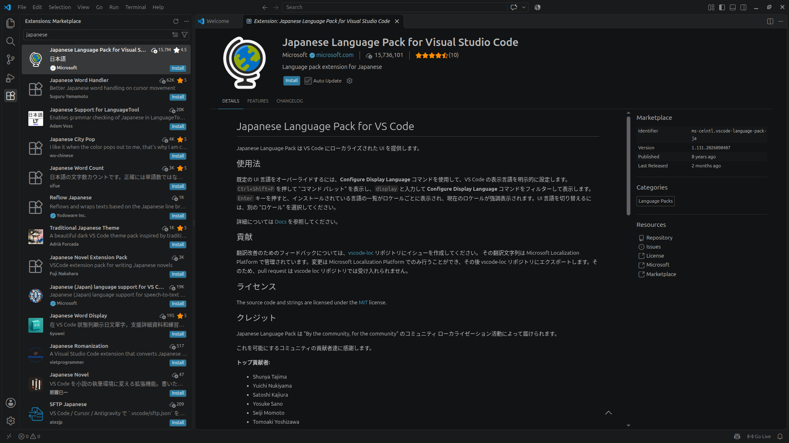
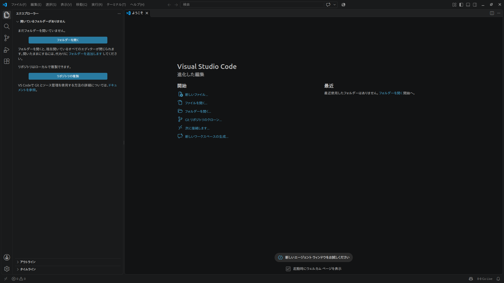

# Gitをどうやって使おうか？
さっそく様々なソフトを入れていきましょう！  
!!! 環境構築
    ここで用語解説です  
    プログラムを作成したり実行するために、必要な準備のことを環境構築といいます。  
    気になった分野を学びたいときは、「C言語 環境構築」などで調べてみるといいかもしれません。

## 準備していく

### VScodeを入れる
では、VSCodeを入れていきましょう。  
すでに入れているよって人はサーッと飛ばしてもらって大丈夫です。

[code.visualstudio.com/download](https://code.visualstudio.com/download)から、インストーラーをダウンロードしてください。  
Windowsって書いてあるボタンをクリックすればダウンロードが始まると思います。  

VSCodeUserSetupなんちゃらかんちゃら.exeファイルがダウンロードできると思います。  

ダブルクリックすると、ウィンドウが開きます。  
規約に同意して、全部次へを押してください。  
デスクトップショートカットが欲しい人は追加しておいてもいいと思います。

続いて日本語化していきましょう。  
一度、VScodeを開いてください。  

左端中央の四角のアイコンをクリックしてください。  
ここが拡張機能のページなっています。

検索窓に「japanese」といれてください。  

「Japanese Language Pack for Visual Studio Code」という、地球儀がアイコンのものがあると思います。  
こちらをクリックして、画面中央の上の方にある、青色のInstallボタンを押してください。  

インストールが終わったら、VScodeの再起動しましょう。  
画面右上のバツ印を押し、もう一度VScodeをつけます。

日本語になっているはずです。

### Gitを入れる
続いてGitを入れていきます。

[git-scm.com/install/windows](https://git-scm.com/install/windows)に飛んでください。  
Click here to downloadをクリックしてください。  
Git-なんちゃらかんちゃら-64-bit.exe がダウンロードされると思います。

