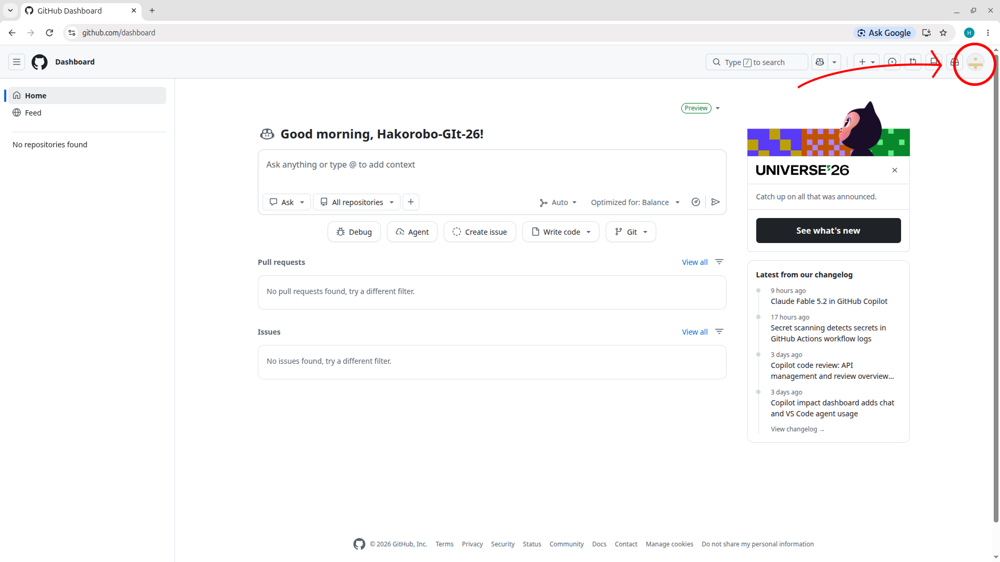
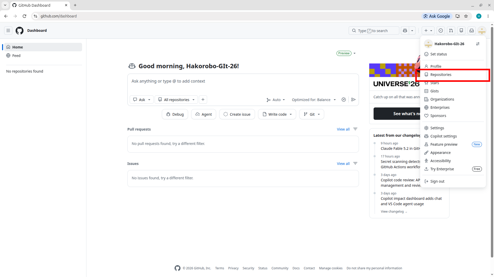
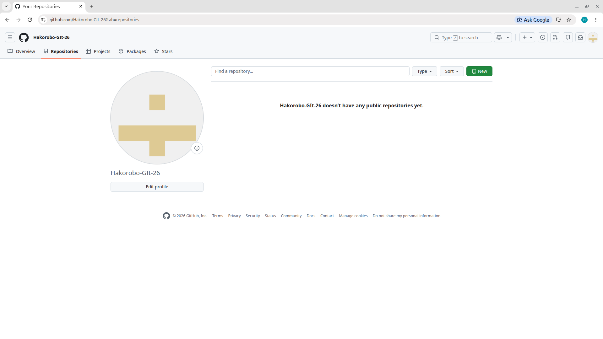
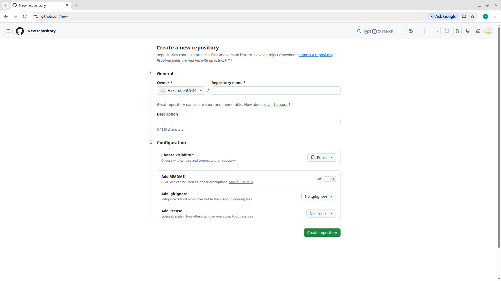
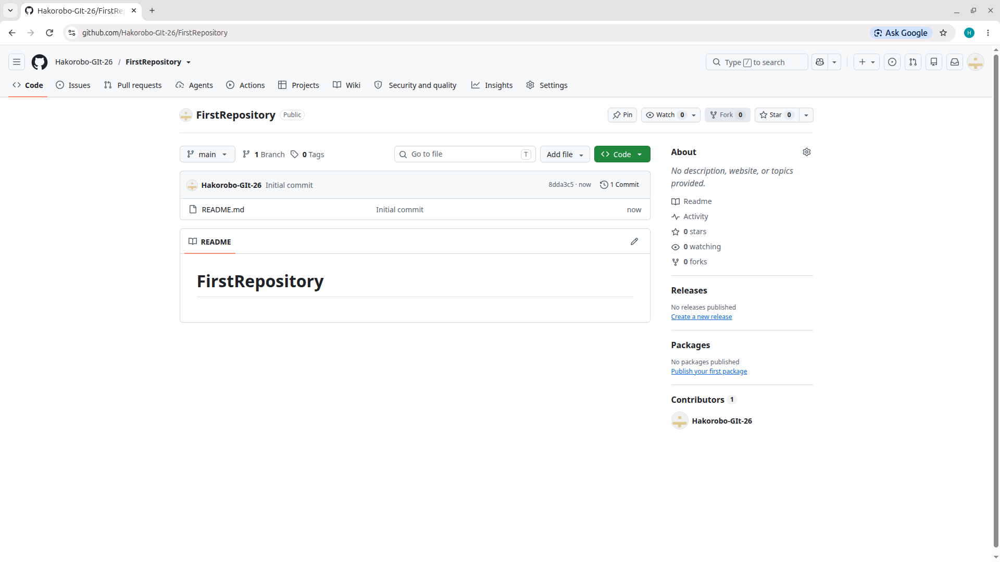

# リポジトリをつくろう
## はじめに
GitHubでは作ったプログラム等をまとまりごとにパッケージ化して保存、他の人に閲覧してもらうことが大きな目的の１つとなります。  
プログラムでいう１パッケージを１リポジトリとしてネット上に公開することができます。

## 作成
アカウントを作り終わったときの画面<a href="https://github.com/dashboard" target="_blank" rel="noopener noreferrer">(こちらをクリック)</a>は、  こんな感じだと思います  
右上の自分のアイコンをクリックしてメニューを表示させます。

続けて、Repositoriesを押してください。

右上にある緑色のNewをクリックしてください。

## リポジトリの設定
リポジトリとはGitHubにおけるプログラムパッケージの最小単位で、リポジトリの名前がそのままパッケージ名であることが多いです。  
なので名前はわかりやすく決めましょう。

上から以下のような意味です。  

| 項目 | 説明 |
|:----|:----|
| **Owner** | リポジトリの所有者を決めます。特にいじる必要はありません。 |
| **Ripository name** | リポジトリの名前です。 |
| **Description** | リポジトリの概要です。基本書かなくてよいです。 |
| **Public or Private** | リポジトリが他の人に見られてもよいかを決めます。Publicだと世界中の人に見られるし、Privateだと許可を与えた人にのみ見えるようになります。基本的にはPublicにしましょう。 |
| **Add README** | READMEファイルを追加するか否かを決定します。基本はOnにしておきましょう。 |

まだ２つほど設定がありますが、変更しなくても良い場所なので今回はスルーします。(Add .gitgnoreとChoose a licenceのこと)

!!! README
    READMEファイルとは「Read me file」、つまり「まず読んでほしいファイル」みたいなものですね。  
    パッケージの内容や使い方が記述されるケースが多いです。

## リポジトリ完成
最後に右下にあった緑色の「Create Repository」を押せばリポジトリの作成は完了です。  

次はリポジトリにフォルダなどを追加してみましょう。

[5.ファイルを追加しよう](./05.add_file.md)  /  [一覧にもどる](./index.md)