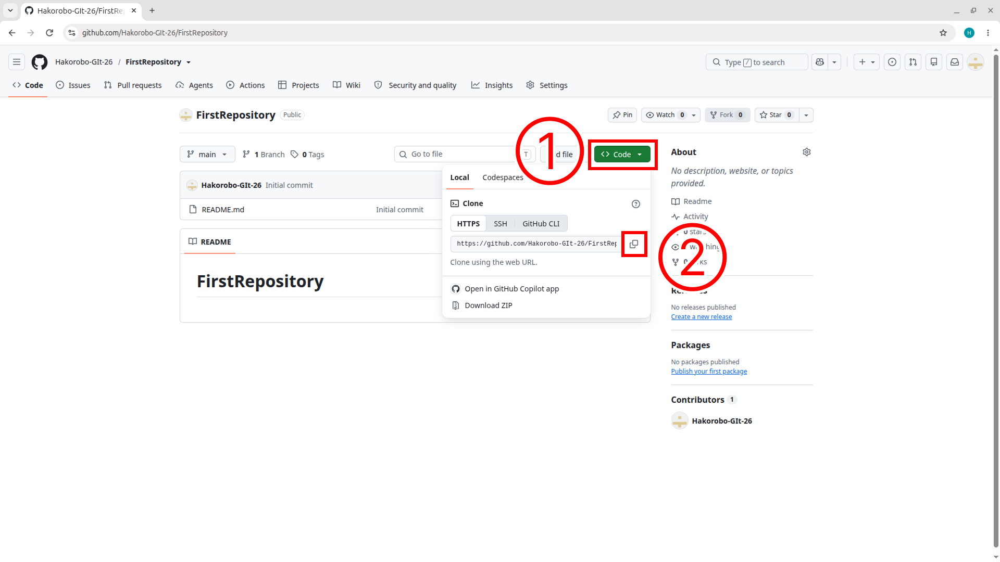
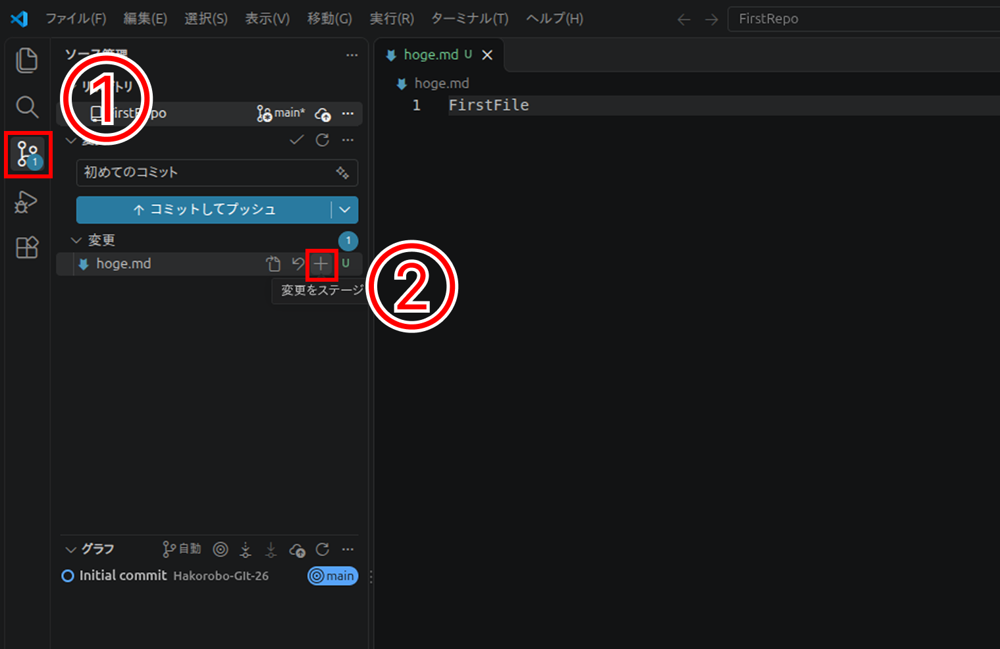
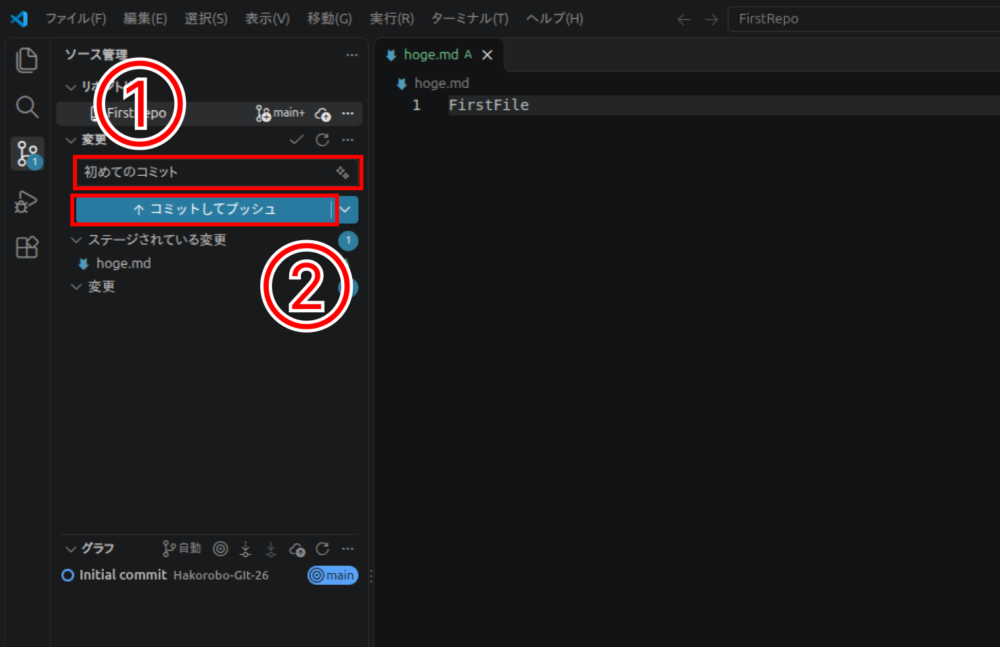
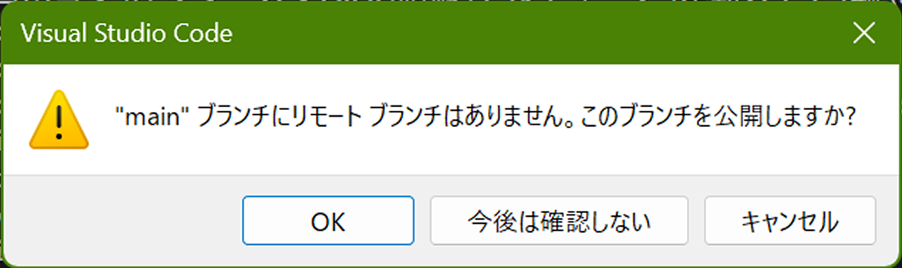
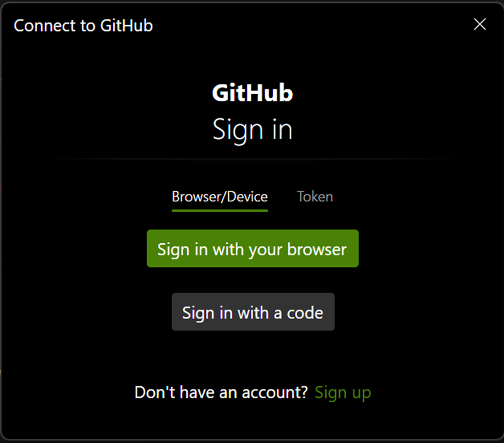
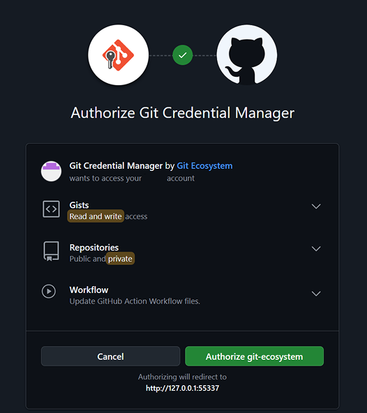
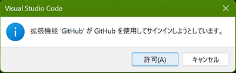
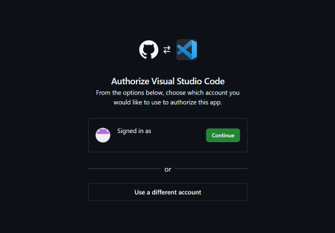
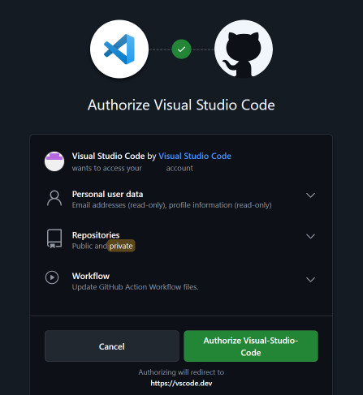
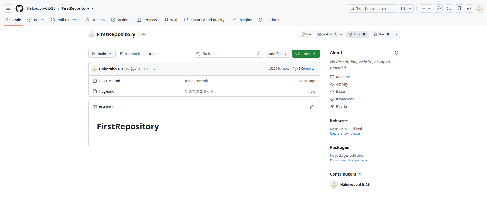

# リポジトリを編集しよう
## 今回の前提について
まずは、今回の前提について触れます。  
手元にすでにアップロードしたいファイルたちがあり、それらをすべてGitHubにアップロードしたい状況であるとします。

## ターミナルを開く
VSCode上でターミナルを開いてみましょう。  
ターミナルとは、プログラマーがつかってそうなコマンドを書くあれです。

では、まずVSCodeの画面左上を見てください。  
2種類の状態が考えられるので、画像に沿って自分の環境に合わせてターミナルを開いてください。

この右下の画面が開けたら、OKです。

## ローカルリポジトリを作成する
では、コマンドを打ってみましょう。  

~~~bash
git init
~~~

以下のように出れば、OKです。  
出なければ、gitが入っているか確認してみてください。

~~~
Initialized empty Git repository in C:/ファイルパス/.git/
~~~

続いて以下のコマンドを打ってみましょう。  
これは、初期ブランチ名が「master」になっているので、「main」に変更しています。

~~~bash
git branch -M main
~~~

これは、なにも返してこないと思います。

## リモートリポジトリとの接続
続いて、リモートリポジトリとローカルリポジトリを紐付けしましょう。  

まずリポジトリのURLを取得しましょう。  
下の画像のようにコピーしてください。  

続いて、以下のコマンドを入力してください。  

~~~bash
git remote add origin コピーしてきたURL
~~~

これも、なにも返してこないと思います。  

## プルする
では、リモートリポジトリの情報を取得しましょう。  

~~~bash
git pull origin main
~~~

ここで、たくさん返ってくると思います。

~~~
remote: Enumerating objects: 3, done.
remote: Counting objects: 100% (3/3), done.
remote: Total 3 (delta 0), reused 0 (delta 0), pack-reused 0 (from 0)
Unpacking objects: 100% (3/3), 868 bytes | 434.00 KiB/s, done.
From https://github.com/user/repository
 * branch            main       -> FETCH_HEAD
 * [new branch]      main       -> origin/main
~~~

こんな感じに表示されればOKです。  

## コミットする
では、コミットしてみましょう。

画像の①を押すとgitに関するメニューを見れます。  
②で今回アップロードするファイルの＋ボタンを押してください。  

①のところにコミット名を入れてください。  
日本語でも、英語でもいいですが、必ず入力してください。  
空白だとエラーが起きてめんどくさいことになります。  

②のボタンを押してください。  

!!! ②のボタンについて
    表記が「コミット」の方は、[こちら](./03.vscode_connect.md#vscode_1)で設定を変えてください。

今回、初めてVSCodeからアップロードしたので、初期設定がはじまります。  

まずはこんなウィンドウが出てくるので、OKを選択しましょう。

続けて、アカウント認証です。  
「Sign in with your browser」を選択しましょう。

普段使っているブラウザが開くと思います。  
「Authorize git-ecosystem」を選択しましょう。

VSCodeに戻ると、こんなウィンドウが出ると思います。  
許可を押しましょう。

ブラウザでこんなページが出ると思うので、「Continue」を押します。

「Authorize Visual-Studio-Code」をクリックしましょう。

VSCodeに戻ってコミットボタンにチェックマークがついたら成功です。

お疲れ様です。  
これにて作業は完了です。

## GitHubで確認
では、確認してみましょう。  
自分のリポジトリページを開いてください。  

無事アップロードできていますね！

[6.考え中](./06.fork_and_pullreq.md)  /  [一覧にもどる](./index.md)